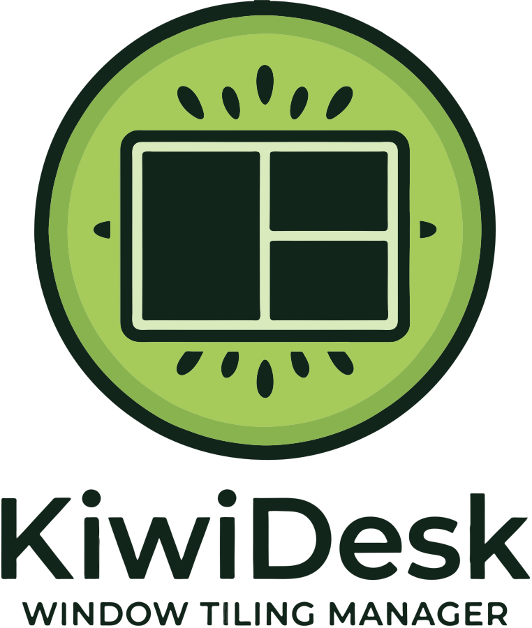
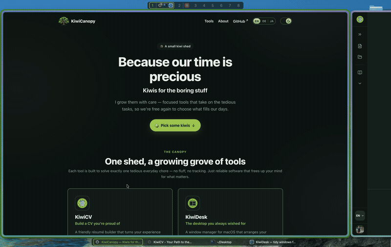

<div align="center">

<picture>
  <source media="(prefers-color-scheme: dark)"
    srcset="assets/dark_logo_wordmark.png">
  
</picture>

### Tiling that feels like it shipped with macOS.

**Start simple. Grow without limits.** KiwiDesk tiles your windows
the moment you install it — no config required. When you want more,
go deeper: custom Lua, profiles, advanced layouts, per-space rules.
Powerful when you reach for it, never in your way.

<br>


[](https://github.com/KiwiCanopy/KiwiDesk/actions/workflows/ci.yml)
[](LICENSE)
[](https://github.com/KiwiCanopy/homebrew-tap)
[](https://github.com/KiwiCanopy/KiwiDesk/releases/latest)

[Website](https://kiwidesk.kiwicanopy.com/) · [Docs](https://kiwidesk.kiwicanopy.com/docs/) · [Quick Start](https://kiwidesk.kiwicanopy.com/docs/user-guide/) · [Recipes](https://kiwidesk.kiwicanopy.com/docs/recipes/) · [Changelog](https://kiwidesk.kiwicanopy.com/changelog/) · [Roadmap](ROADMAP.md) · [Discord](https://discord.gg/bYeTrJyZyS) · [Sponsor](https://github.com/sponsors/KiwiCanopy)



</div>

## Why KiwiDesk?

I love tiling window managers, but I could never seriously recommend
one to a friend who doesn't live in a terminal. On macOS, most of them
make you write a config file before you can even move a window — they
feel more like a nerd's construction kit than actual software.

I want KiwiDesk to be different. A few ideas drive how I build it:

- **It just works out of the box.** Download it, grant one permission,
  press Start — no dotfiles to get going, and in-app updates so you
  never think about maintenance.
- **Opinionated, but adaptable.** It ships with strong default
  workflows that make sense right away, and you can still bend and
  tweak it to your heart's content.
- **Performance and UI/UX are equally non-negotiable.** I won't trade
  one for the other. If the UI is clumsy, people lose interest or end
  up scripting around it; if it lags, power users leave. It has to feel
  both polished and light.
- **Still very much a nerd's toy.** Approachable doesn't mean
  neutered: there's a Lua config, a proper CLI and an event stream, so
  you can script whatever setup you want.
- **Built to survive macOS updates.** Every private Apple API has a
  public fallback, and the few things only Apple's own bridge can do
  switch themselves off after an update instead of breaking your
  desktop.

[How it compares with yabai, AeroSpace and the rest →](https://kiwidesk.kiwicanopy.com/compare/)

[Everything it does, feature by feature →](https://kiwidesk.kiwicanopy.com/nerd/#features)

## Installation

Requirements: macOS 14 or later, on Apple silicon.

```sh
brew install --cask kiwicanopy/tap/kiwidesk
```

Or **[download the `.dmg`](https://kiwidesk.kiwicanopy.com/)** — the
same signed, notarized app; the cask additionally puts the `kiwidesk`
CLI on your `PATH`. Either way KiwiDesk checks for updates itself.

On first launch a wizard walks you through the Accessibility
permission; nothing moves until you press **Start Tiling**. Everything past
that — Settings, the CLI, Lua — is in the
**[Quick Start](https://kiwidesk.kiwicanopy.com/docs/user-guide/)**.

### Building from source

For contributors, or to run an unreleased commit. Requirements:
Xcode 27+ / Swift 6.4 (the app itself runs on macOS 14+).

```sh
git clone https://github.com/KiwiCanopy/KiwiDesk.git
cd KiwiDesk
swift build -c release
.build/release/KiwiDesk           # run the app
```

## Contributing

See [CONTRIBUTING.md](CONTRIBUTING.md) and [AGENTS.md](AGENTS.md); AI coding
agents are welcome. To report a vulnerability, see [SECURITY.md](SECURITY.md).

Questions and ideas go to
[Discussions](https://github.com/KiwiCanopy/KiwiDesk/discussions), where
the answer helps the next person too. To chat, share a setup or follow
releases, join the [Discord](https://discord.gg/bYeTrJyZyS).

## License

[Business Source License 1.1](LICENSE): using KiwiDesk is free, at home
and at work; offering, selling, bundling or hosting it or a derivative
as a product or service needs a commercial license. Each version
becomes [MIT](https://opensource.org/license/mit) four years after publication.

---

KiwiDesk's source is public. If you like it, leave a ⭐ — it is the
one thing that helps other people find it.

<div align="center">
<br>
<sub>A <a href="https://kiwicanopy.com"><strong>KiwiCanopy</strong></a> project — Because our time
is precious 🥝</sub>
</div>
